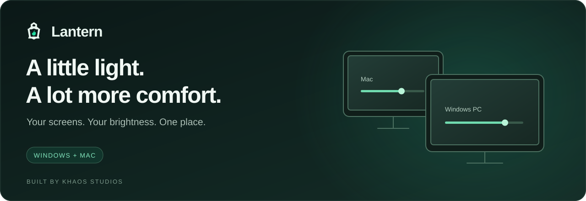

<p align="center">
  
</p>

<p align="center">
  Comfortable brightness for every screen, from your system tray or menu bar.
  <br>
  Adjust one display, a whole computer, or your connected computers together.
</p>

<p align="center">
  <a href="https://github.com/snacbot/lantern-releases/releases">Release notes</a> &nbsp; · &nbsp;
  <a href="https://github.com/snacbot/lantern-releases/issues">Get help</a> &nbsp; · &nbsp;
  <a href="https://buymeacoffee.com/khaosstudios">Buy Me a Coffee</a>
</p>

## Find your Lantern

| Windows | Mac · Public preview |
| :--- | :--- |
| **[Download for Windows ↗](https://github.com/snacbot/lantern-releases/releases/latest/download/Lantern-setup.exe)** | **[Download for Mac ↗](https://github.com/snacbot/lantern-releases/releases/download/mac-v0.2.0/Lantern.dmg)** |
| Windows 10 or later · x64 | macOS 13 or later · Apple Silicon & Intel |
| Run setup, then find Lantern in your system tray. | Open the DMG, drag Lantern to Applications, then open it. |
| [Windows release notes](https://github.com/snacbot/lantern-releases/releases/latest) | [Mac preview notes](https://github.com/snacbot/lantern-releases/releases/tag/mac-v0.2.0) |

<details>
<summary><strong>Prefer Homebrew?</strong></summary>

```sh
brew install --cask snacbot/tap/lantern
```

Use the full cask name above: `brew install --cask lantern` installs an unrelated app.
Both apps use `Lantern.app`, so they cannot share an applications folder.

</details>

## Make every screen feel right

| A calmer workspace | Less reaching for controls |
| :--- | :--- |
| **Fine-tune each display.** Set brightness individually or adjust a whole group at once. | **Connect your computers.** Bring your Windows PC and Mac into the same local workspace. |
| **Keep your setup tidy.** Rename, reorder, or hide displays to match your desk. | **Save your favorites.** Use presets and keyboard shortcuts for the brightness you like. |
| **Dim more displays.** Use software dimming where supported, including DisplayLink setups. | **Get back to full brightness.** Restore your local screens with a button or keyboard shortcut. |

## Small setup. Everyday comfort.

1. **Install Lantern** on the computers you want to control.
2. **Open the tray or menu bar icon** to find your displays and adjust brightness.
3. **Connect on a trusted local network** using the same Lantern connection port on each computer.

Hardware brightness depends on your monitor, cable and dock. Software dimming darkens the image while Lantern is running; it does not turn off the physical backlight.

## Good to know

<details>
<summary><strong>Compatibility & the Mac preview</strong></summary>

Windows targets Windows 10 or later on x64. Mac targets macOS 13 or later on Apple Silicon and Intel and remains a public preview.

Mac external hardware DDC control requires Apple Silicon and a compatible connection. Intel external displays and DisplayLink can use software dimming. Compatibility varies by display and dock; broader testing of older macOS versions, Intel, sleep/wake, hotplug and fullscreen/Spaces remains in progress.

Experimental display power tests are separate from everyday brightness controls. DisplayLink backlight-off is not a verified feature.

</details>

<details>
<summary><strong>Restore brightness quickly</strong></summary>

| Windows | Mac |
| :--- | :--- |
| **Ctrl + Alt + Home** | **Control + Option + Command + R** |

Both shortcuts restore local screens to 100%. Current Windows and Mac releases also support shaking your pointer to restore brightness. Change this in **Settings → General**.

</details>

<details>
<summary><strong>Automatic updates & upgrading</strong></summary>

Current releases download and verify signed updates, preserve settings and restart Lantern to apply them. Windows and Mac receive their own platform updates.

If your Windows copy lives in Program Files, run the latest setup once to move to the current user-writable location. Setup needs administrator approval for firewall and protected-file maintenance; ordinary startup and subsequent automatic updates do not. Older updaters may request approval during that transition. Protected Mac installation folders may require system authorization.

</details>

<details>
<summary><strong>Local network connections</strong></summary>

Lantern exchanges computer names, display details and brightness state with peers on your local network. Use native LAN control only on a trusted network and never expose it directly to the internet. LAN defaults differ by release; review **Settings → Network** on each computer. Phone control has a separate opt-in and pairing key.

Automatic updates contact release and download servers. Payments open on Buy Me a Coffee; Lantern does not handle card details.

</details>

## A little help goes a long way

**Something not quite right?** [Report an issue](https://github.com/snacbot/lantern-releases/issues) with your Lantern and OS versions, monitor model, and cable or dock details. Review screenshots and logs for private computer names, addresses and pairing keys before posting.

**Enjoying Lantern?** [Buy Me a Coffee](https://buymeacoffee.com/khaosstudios) to support continued development. Tips are always optional.

---

<p align="center">
  Built by <a href="https://khaosstudio.com/"><strong>Khaos Studios</strong></a> · Supported by you.
  <br>
  <sub>This repository hosts public downloads, release notes and support. Source development is maintained separately.</sub>
</p>
